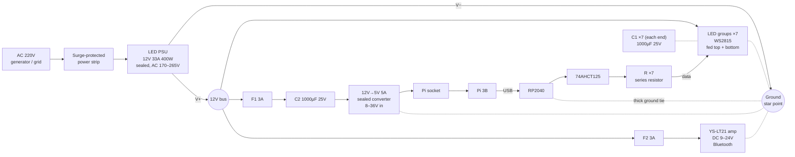

# Power

This is power plan for future lon term installation. ignore it for the current setup (Nov 26)

Rule: keep only what the components need to survive. The installation runs where there are no spare parts or tools.

One AC plug feeds everything through a single 12V PSU. Because the LEDs and the logic power up together, the LEDs can never come on before the controller.

## Circuit

## Components

| Ref | Part | Why (what it prevents) |
|---|---|---|
| PSU | 12V 33A 400W sealed LED driver | Powers everything; sealed, so dust is not a problem |
| — | Surge-protected power strip | Generator spikes killing the PSU |
| DCDC | 12V→5V 5A sealed converter, wide input (8–36V), set to 5.1–5.2V | Pi browning out when LED load sags the 12V |
| C1 ×7 per end | 1000µF 25V electrolytic, across V+/V− at each LED feed point | Power-on voltage spike killing the first pixel of each group |
| C2 | 1000µF 25V electrolytic at the converter input | Short 12V dips resetting the Pi |
| F1, F2 | 3A inline blade fuses | Thin wires overheating or burning on a partial short (below the PSU's 33A trip) |
| BUF | 74AHCT125 (already installed) | Takes the hit instead of the RP2040 if something goes wrong on a data line |
| R ×7 | Series resistors on the data lines (already installed) | Limits fault current into the data pins |
| — | Thick ground tie, screw terminal: RP2040 GND to the PSU V− star point | LED current returning through a data wire (how the old pin burned) |

## Wiring rules

- Never put a fuse or switch on the ground side.
- The ground tie must not use a connector that can come off while the data wires are still attached.
- Mind capacitor polarity: the stripe goes to V−.
- Fusing the LED groups is optional if their wiring is thick and protected from chafing.
